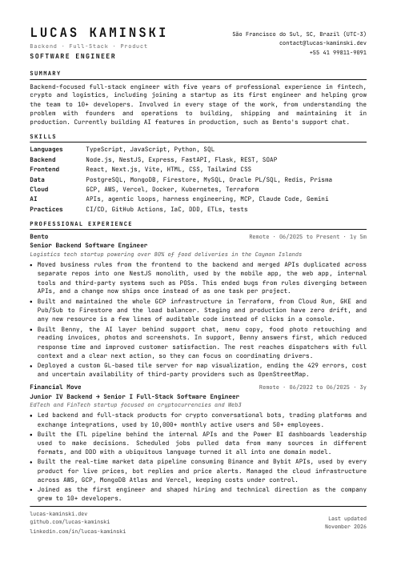
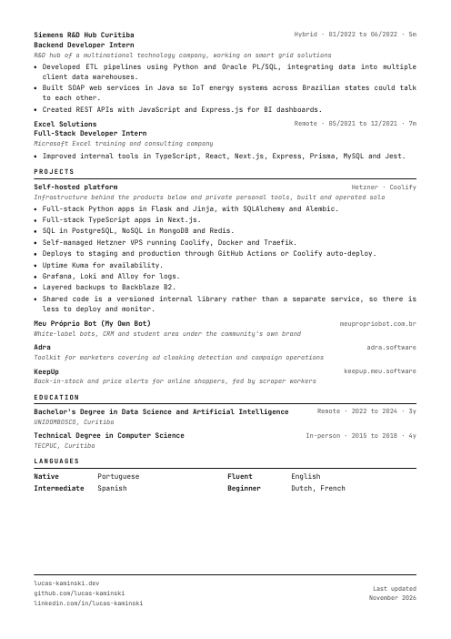

# Lucas Kaminski — CV

**[Download the latest PDF](https://github.com/lucas-kaminski/curriculum-vitae/releases/latest/download/Lucas_Kaminski_CV.pdf)**

  
  

## How it's built

The CV is a single HTML file, `cv.html`, printed to PDF by headless Chrome.
`build.sh` renders twice: the first pass counts pages, the second stretches the
body so the footer sits at the foot of the last page.

    ./build.sh              # -> dist/Lucas_Kaminski_CV.pdf
    ./build.sh cv-node.html # -> dist/Lucas_Kaminski_CV_node.pdf

Building `cv.html` also refreshes `docs/preview-*.png` and uploads the PDF to a
GitHub release tagged with the day. Needs Google Chrome, poppler-utils and `gh`.

A pre-commit hook in `.githooks` runs the build whenever `cv.html` is committed
(enable it once with `git config core.hooksPath .githooks`).

To tailor it for a role, copy `cv.html` and edit. Git history is the version log.
